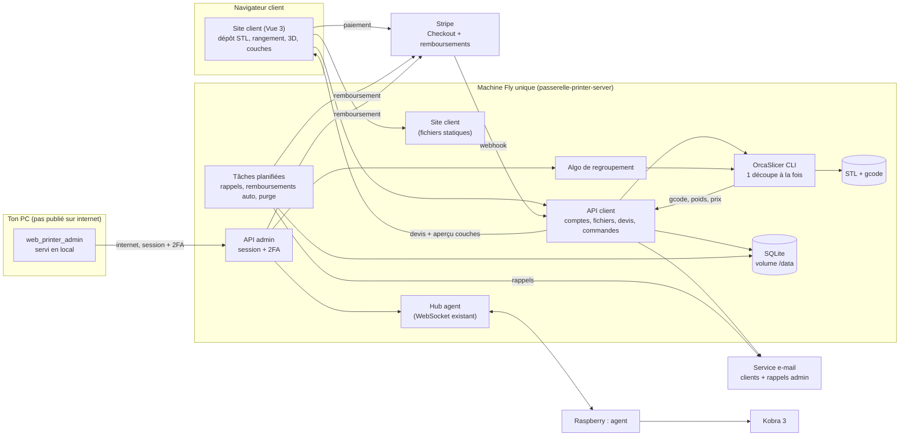
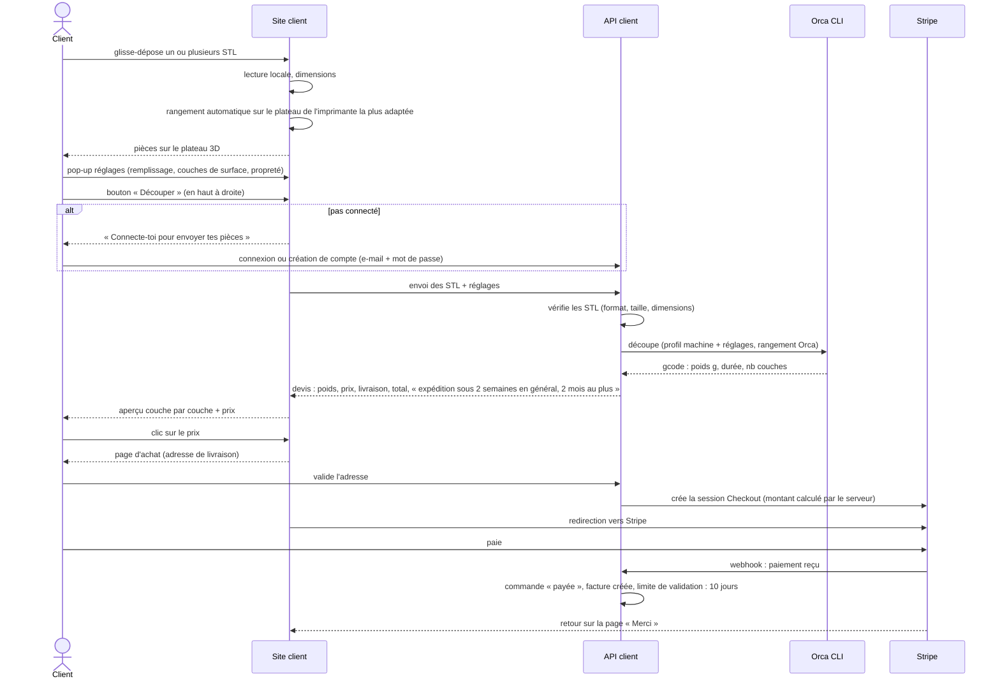
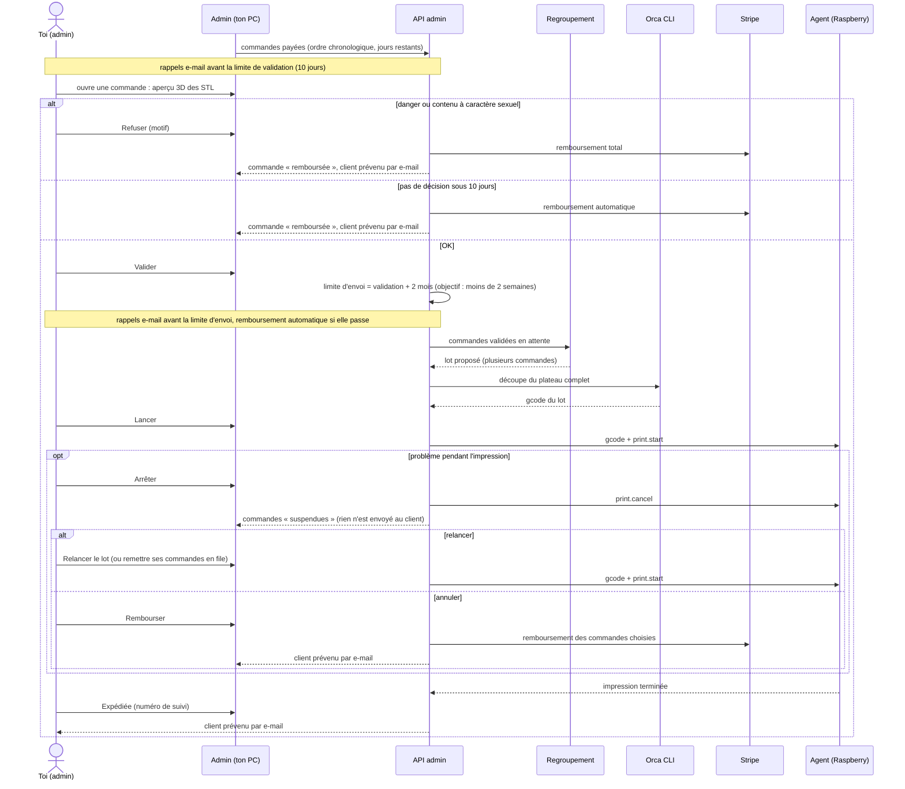
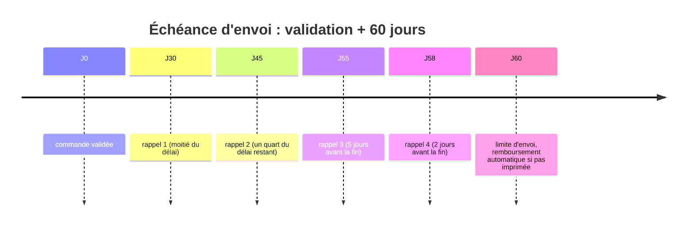
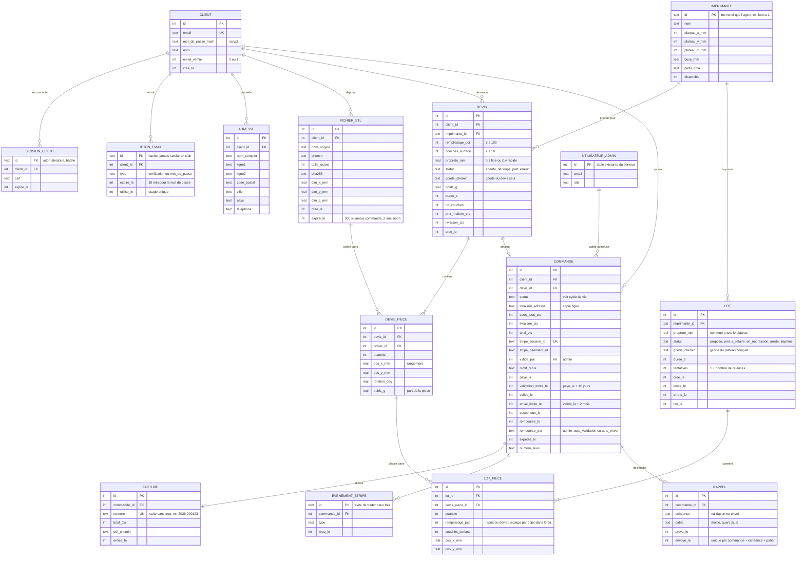
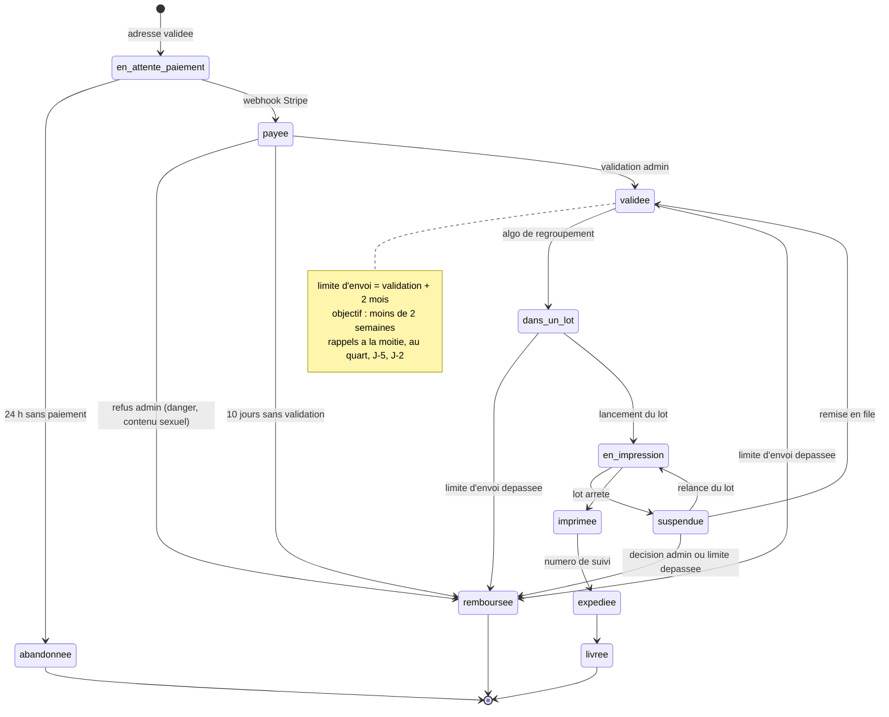

# web_printer_user — conception (v5, validée le 2026-11-19)

Site public : un client dépose **un ou plusieurs STL**, un algorithme les range sur le plateau de
l'imprimante la plus adaptée, il règle solidité et propreté, OrcaSlicer (CLI) découpe et calcule poids et
prix, le client voit le résultat couche par couche et paie avec Stripe.

Côté admin (`web_printer_admin`, **en local sur ton PC**, pas publié) :
- tu **valides ou refuses** chaque commande payée ; sans décision sous **10 jours**, remboursement
  automatique ;
- une fois validée, tu as **2 mois au plus pour l'envoyer** (objectif : moins de 2 semaines) ; passé ce
  délai, remboursement automatique ; des **e-mails de rappel** t'avertissent avant chaque échéance ;
- un algorithme **regroupe plusieurs commandes sur un même plateau** ;
- si tu arrêtes une impression, tu peux **la relancer sans rembourser ni prévenir le client** ;
- les STL commandés sont gardés **2 ans**, puis supprimés.

> v5 validée : remboursement automatique à la limite d'envoi, admin en local, STL commandés gardés 2 ans,
> objectif d'envoi sous 2 semaines.

---

## 1. Architecture



- **Avant connexion**, les STL restent dans le navigateur du client (affichage, rangement, réglages).
- **Orca découpe deux fois** :
  1. pour le **devis** du client (sa commande seule) : poids, durée, prix, aperçu couche par couche ;
  2. pour le **lot** à imprimer, quand plusieurs commandes sont regroupées sur un plateau : c'est ce gcode-là
     qui part à l'imprimante.
- **Le prix est toujours calculé par le serveur**, jamais par le navigateur.
- **Comptes séparés** : les clients sont dans `CLIENT`, toi dans les utilisateurs admin existants (avec 2FA).
  Une session client ne peut jamais appeler l'API admin.
- **Le site admin n'est servi par personne sur internet** : ses fichiers restent sur ton PC (tu gères toi-même
  une éventuelle PWA en local). L'API admin, elle, reste joignable, protégée par la session et la 2FA comme
  aujourd'hui.

## 2. Parcours client



## 3. Parcours admin : de la commande payée à l'envoi



## 4. Délais et rappels

Deux échéances par commande, chacune avec ses rappels **envoyés à toi** par e-mail :

| Échéance | Départ | Durée | Si elle passe |
| --- | --- | --- | --- |
| **Validation** | paiement | 10 jours | remboursement automatique |
| **Envoi** | validation | 2 mois maximum, objectif moins de 2 semaines | remboursement automatique (voir ci-dessous) |

**Limite d'envoi dépassée** (proposition) :
- commande pas encore imprimée (validée, dans un lot pas lancé, suspendue) : **remboursement automatique** et
  e-mail au client. Si elle était dans un lot pas encore lancé, le lot est marqué « à refaire » (il faut le
  redécouper sans elle) ;
- commande **en cours d'impression ou déjà imprimée** : pas de remboursement automatique (la pièce existe ou
  va exister), mais une alerte pour que tu l'expédies ou que tu décides toi-même.

Dans ta liste de commandes, celles qui dépassent l'objectif de 2 semaines sont signalées « en retard sur
l'objectif ».

Rappels, pour chaque échéance :
1. à la **moitié** du délai ;
2. quand il reste **un quart** du délai ;
3. **5 jours** avant la fin ;
4. **2 jours** avant la fin.

Deux rappels qui tombent à moins de 24 h d'écart n'en font qu'un (on garde le plus tardif). Exemple pour
l'envoi, sur 2 mois (60 jours) :



Pour la validation (10 jours), la moitié et « 5 jours avant » tombent le même jour, et le quart restant
(J7,5) est à moins de 24 h de « 2 jours avant » (J8) : il reste **2 rappels, à J5 et J8**.

Une commande suspendue garde sa limite d'envoi : pas de délai à part, les rappels continuent.

## 5. MLD (base SQLite du serveur)



Choix importants :
- **Montants en centimes entiers.** Prix et adresse **copiés dans la commande**.
- **`DEVIS_PIECE`** : une commande peut contenir plusieurs STL, chacun avec sa quantité et sa place.
- **`LOT` et `LOT_PIECE`** relient un gcode imprimé aux commandes qu'il contient. Chaque pièce garde son
  remplissage et ses couches de surface dans le lot. Un lot arrêté garde son gcode : le relancer ne demande
  pas de nouvelle découpe.
- **`RAPPEL`** : un rappel n'est jamais envoyé deux fois, même si le serveur redémarre.
- **`JETON_EMAIL`** : vérification de l'e-mail et lien éphémère « mot de passe oublié » (30 min, usage
  unique, stocké haché).
- **`FACTURE`** : numérotation continue, obligatoire en France.

## 6. Conservation des fichiers

| Fichier | Conservé | Pourquoi |
| --- | --- | --- |
| STL **jamais commandé** (devis abandonné) | 30 jours après le dépôt | rien à imprimer, on ne garde pas les fichiers des gens pour rien |
| STL **d'une commande** (payée, même remboursée) | **2 ans** après le dépôt | réimpression, litige, ta bibliothèque de STL |
| gcode d'un devis | 30 jours après la fin de la commande | Orca peut le refaire à partir du STL |
| gcode d'un lot | 30 jours après l'impression | idem |
| factures | 10 ans | obligation comptable (pas de STL dedans) |

Une tâche planifiée quotidienne supprime ce qui a dépassé sa durée. Une commande ne peut pas durer plus de
10 jours + 2 mois : ses STL sont toujours là quand il faut découper son lot.

La durée de 2 ans devra être écrite dans la page « Confidentialité ». Un client peut aussi demander la
suppression de ses fichiers avant (droit à l'effacement du RGPD) : prévoir un bouton dans « Mes commandes »
pour les commandes terminées.

## 7. Cycle de vie d'une commande



- **Suspendue** : rien n'est envoyé au client. Tu relances le même lot, remets ses commandes dans la file,
  ou rembourses. La limite d'envoi continue de courir.
- **En impression ou imprimée** à la limite d'envoi : pas de remboursement automatique, une alerte à la place.
- **Le client n'est prévenu que** du paiement reçu, d'un remboursement, et de l'expédition.
- **Remboursement « instantané »** : l'appel à Stripe est immédiat et la commande passe tout de suite en
  « remboursée ». L'argent met en général 5 à 10 jours ouvrés à revenir sur la carte : c'est la banque.

## 8. Algorithme de regroupement

But : imprimer plus vite sans faire attendre personne trop longtemps.

1. File des commandes **validées**, triée par **limite d'envoi** (la plus proche d'abord), c'est-à-dire par
   ordre chronologique de validation.
2. On ouvre un plateau avec la commande la plus urgente. Elle fixe la **propreté** (hauteur de couche) et le
   **filament** du lot. Le remplissage et les couches de surface restent propres à chaque pièce : Orca les
   règle objet par objet.
3. On parcourt les commandes suivantes dans l'ordre. Chaque commande de même propreté et même filament est
   ajoutée si toutes ses pièces rentrent sur la place restante (rangement 2D des empreintes, avec une marge).
4. On arrête quand le plateau est plein, ou quand le lot dépasse une durée maximale (ex. 12 h).
5. Orca découpe le plateau complet. Tu vois l'aperçu, puis tu lances ou tu ajustes le lot.

Une commande n'est jamais dépassée par une moins urgente qui ne rentre pas avec elle : la plus urgente ouvre
toujours le lot suivant.

## 9. Réglages proposés au client (pop-up)

| Groupe | Réglage | Valeurs | Paramètre Orca |
| --- | --- | --- | --- |
| Solidité | Remplissage | 5 à 100 %, défaut 15 % | `sparse_infill_density` (par objet) |
| Solidité | Couches de surface | 2 à 10, défaut 3 | `top_shell_layers` et `bottom_shell_layers` (par objet) |
| Propreté | Fine | couches de 0,2 mm + lissage de la face visible | `layer_height = 0.2`, `ironing_type = top` |
| Propreté | Rapide | couches de 0,4 mm, sans lissage | `layer_height = 0.4`, `ironing_type = no ironing` |

Ces réglages s'appliquent à toutes les pièces d'une même commande. Le serveur ne transmet à Orca que ces
valeurs, prises dans ces listes.

## 10. Prix de vente

- **Matière** : 0,20 € par gramme de PLA, poids lu dans le gcode d'Orca.
- **Livraison** : 5 € de base, plus un supplément selon le poids du colis :

| Poids du colis | Livraison |
| --- | --- |
| jusqu'à 250 g | 5,00 € |
| 251 à 500 g | 6,50 € |
| 501 g à 1 kg | 8,00 € |
| 1 à 2 kg | 10,00 € |
| au-delà | 10,00 € + 2,00 € par kg entamé |

Grille modifiable dans un fichier de configuration.

## 11. Coût d'hébergement (Fly)

Tarifs Fly relevés sur docs.fly.io/about/pricing (régions les moins chères ; Paris peut être un peu plus
cher), pour une machine allumée en permanence :

| Machine | Prix / mois | Pour quoi |
| --- | --- | --- |
| shared-cpu-1x, 512 Mo | 3,69 $ | **ta machine actuelle**, sans Orca |
| shared-cpu-1x, 1 Go | 6,70 $ | serveur + site client + Orca, avec 1 Go de swap en secours |
| shared-cpu-2x, 2 Go | 13,39 $ | si Orca manque de mémoire sur de gros plateaux |

- Volume : 0,15 $ par Go et par mois. Avec des STL commandés gardés 2 ans, le volume grossit avec ton
  activité. Exemple : 50 commandes par mois avec 10 Mo de STL chacune, c'est 0,5 Go par mois, donc environ
  12 Go au bout de 2 ans (1,80 $ par mois). Les STL seront stockés compressés (gzip), ce qui réduit souvent
  leur taille de moitié ou plus. Un volume Fly s'agrandit sans coupure quand il le faut.
- Fly ne facture pas un mois sous 5 $ : c'est sans doute ton cas aujourd'hui, ça ne le sera plus avec 1 Go.
- Stripe prend une commission sur chaque paiement, en plus de l'hébergement.

Proposition : **commencer à 1 Go + swap** (`swap_size_mb = 1024` dans `fly.toml`), mesurer la mémoire
d'Orca sur un vrai plateau, et ne passer à 2 Go que si besoin.

## 12. Arborescence prévue

```
web_printer_admin/        sur ton PC seulement : pilotage (existant) + commandes, lots, factures, STL
web_printer_user/
  front/                  Vue 3 + Vite + Vue Router + Pinia + three.js
    src/pages/            Accueil (dépôt STL), Connexion, Mot de passe oublié, Devis, Achat, Merci,
                          Mes commandes, CGV, Mentions légales, Confidentialité (ces 3 vides pour l'instant)
    src/components/       Plateau3D, Rangement, PopupReglages, VueCouches, CartePrix
serveur/                  serveur existant : + routes client, Orca, Stripe, lots, rappels, tâches planifiées
  orca/                   profils Orca de chaque imprimante (machine, process, filament)
Dockerfile                + build du site Vue + OrcaSlicer dans l'image
```

## 13. Décisions prises

1. **Propreté** : Fine = 0,2 mm + lissage, Rapide = 0,4 mm sans lissage.
2. **Comptes** : e-mail + mot de passe, vérification de l'e-mail, lien éphémère pour le mot de passe oublié.
3. **Plusieurs STL** par commande, rangés automatiquement (aperçu dans le navigateur, rangement définitif
   par Orca).
4. **CGV, mentions légales, confidentialité** : pages vides pour l'instant.
5. **Une seule machine Fly** pour le serveur, le site client et Orca. **Admin en local** sur ton PC.
6. **Modération obligatoire** : sans décision sous 10 jours, remboursement automatique.
7. **Après validation** : 2 mois au plus pour envoyer, objectif moins de 2 semaines ; limite dépassée =
   remboursement automatique. Une commande suspendue n'a pas de délai à part.
8. **Lot arrêté** : commandes suspendues, sans remboursement ni message au client.
9. **Remplissage et couches de surface par pièce** dans un même lot (réglages par objet d'Orca).
10. **Rappels e-mail** : moitié, quart restant, J-5, J-2, pour la validation et pour l'envoi.
11. **STL commandés gardés 2 ans**, puis supprimés.
12. **STL jamais commandés** : supprimés au bout de 30 jours.
13. **Commande en cours d'impression ou imprimée** à la limite d'envoi : alerte, pas de remboursement
    automatique.

## 14. Ordre de réalisation

Chaque étape donne quelque chose d'utilisable et de testable avant de passer à la suivante.

1. **Base de données et comptes clients** : tables, inscription, vérification de l'e-mail, mot de passe
   oublié (avec un service d'e-mail à choisir).
2. **Site client Vue, sans serveur** : dépôt de plusieurs STL, rangement, plateau 3D, pop-up de réglages.
3. **Orca sur la machine Fly** : profils Kobra 3, découpe d'un devis, poids, prix, aperçu couche par couche.
   C'est l'étape la plus incertaine (taille de l'image, mémoire), à tester tôt.
4. **Commande et paiement Stripe** en mode test : adresse, Checkout, webhook, facture.
5. **Admin : commandes** : liste, aperçu, valider ou refuser, remboursement, tâches planifiées (10 jours,
   2 mois, rappels, purge).
6. **Admin : lots** : regroupement, découpe du plateau, lancement par l'agent, arrêt et relance.
7. **Pages légales vides**, puis passage de Stripe en mode réel.
